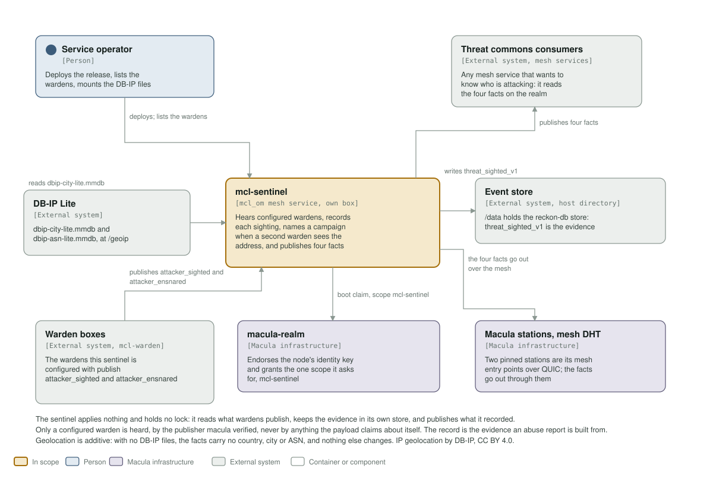

# mcl-sentinel

<!-- Service README template: swap the service name in the badge URLs and the
     package link; everything else is shared. -->

  <picture>
    <source media="(prefers-color-scheme: dark)" srcset="assets/macula-full-dark.svg">
    
  </picture>

  <strong>Correlates warden sightings into cross-border campaigns and publishes them, enriched, to the threat commons.</strong>

---

This exists so an attacker seen by one box is known to every box, and one seen
by two is named as a campaign, before it reaches the next door.

## Status

Released as 0.2.0 on macula 14.2 through `mcl_om` 0.38. It replaces
the macula 10 sentinel service and inherits nothing from it: no identity, no
volume, no topic.

0.3.0 moved it to wire 1.0: macula 15.6 through `mcl_om` 1.0, on the flag day
(macula-io/macula-fleet#27), when the whole fleet moved together.

0.4.0 moves it to macula 18 through `mcl_om` 1.6. 18 keeps wire 1.0, so this
build still speaks to every wire 1.0 box; nothing it declares is asked anything
new, since it advertises no capability and declares no subscription.

## What it does

1. **Hears** `mcl-warden`'s `attacker_sighted` and `attacker_ensnared`, and
   takes a report only from a configured warden, by the publisher macula
   verified. Nothing a payload says about its own sender is believed.
2. **Records** each sighting as `threat_sighted_v1` in its own event store: the
   immutable evidence an abuse report is built from, kept off the attacked
   boxes. A redelivered sighting addresses the stream it is already in and is
   refused, so the record never inflates.
3. **Correlates** in an in-memory read model keyed by source address. An
   address seen by a second warden is a **campaign**.
4. **Publishes** four facts: what it recorded, enriched with where the attacker
   is; a tarpit capture as `attacker_ensnared`; the campaign the moment it
   becomes one; and a 60-second heartbeat, `sentinel_checked_in`.

The read model is rebuilt from the store once at boot, and after that folded
only as sightings are recorded. There is no projection: evoq replays the whole
store to every handler on each boot, so a projection would count history twice
and announce every old campaign again as new.

## The fact contract

Four canonical macula app facts, org `mcl-sentinel`, app `sentinel`, domain
`watch`, in the configured realm:

| Topic | When |
|---|---|
| `<realm>/mcl-sentinel/sentinel/watch/attacker_sighted_v1` | a warden sighting was recorded |
| `<realm>/mcl-sentinel/sentinel/watch/attacker_ensnared_v1` | a warden's tarpit held an attacker until it gave up |
| `<realm>/mcl-sentinel/sentinel/watch/campaign_detected_v1` | an address has just been seen by its second warden |
| `<realm>/mcl-sentinel/sentinel/watch/sentinel_checked_in_v1` | heartbeat, every 60 s |

| Fact | Keys |
|---|---|
| `attacker_sighted` | `sighting_id`, `epoch`, `seq`, `source_ip`, `warden_id`, `service`, `attempts`, `window_s`, `usernames`, `at_ms`, optional `label`, `tenant_id` |
| `attacker_ensnared` | `source_ip`, `warden_id`, `held_ms`, `at_ms`, optional `label`, `tenant_id` |
| `campaign_detected` | `source_ip`, `warden_ids`, `warden_count`, `labels`, `head_start_ms`, `total_attempts`, `usernames`, `first_seen_ms`, `last_seen_ms`, `at_ms` |
| `sentinel_checked_in` | `epoch`, `seq`, `interval_s`, `at_ms` |

Every fact but the heartbeat also carries geolocation when it is known:
`country_iso`, `country`, `city`, `lat_e6`, `lng_e6`, `asn`, `asn_org`,
`net_type` (`hosting`, `isp` or `unknown`).

Rules a consumer can rely on:

- `warden_id` is the reporting warden's verified node id, upper-case hex.
  `label` and `tenant_id` are what that warden says about itself.
- `seq` counts recorded sightings within one `epoch` (set at each boot). A gap
  in `seq` is a lost fact; a new `epoch` is a restart, across which no
  continuity is claimed. The heartbeat carries the current pair, so a consumer
  that stops hearing it knows it is deaf, not that the commons is quiet.
- `head_start_ms` is how long the commons knew about the address before the
  latest warden saw it.
- `usernames` holds at most 20. Values are binaries, integers and lists of
  binaries; coordinates are integer micro-degrees; times are milliseconds since
  the epoch.
- A change to any of this is a new `_v2` topic. The contract is pinned in
  `apps/mcl_sentinel/test/mcl_sentinel_facts_tests.erl`.

**Geolocation: IP Geolocation by [DB-IP](https://db-ip.com), CC BY 4.0.** Anything
that shows the geolocation fields credits DB-IP.

Like every mcl service, it also answers the two procedures `mcl_om` adds to
each of them, both open. `mcl-sentinel/info` gives its name, version and
description, its org and claim labels, node id, the macula and mcl_om versions,
uptime, the health word and the procedures it advertises;
`mcl-sentinel/get_limits` gives the inbound guard's limits and current-window
stats for one procedure or all of them. Open to any mesh caller, public facts
only.

## Configuration

| Variable | Default | Meaning |
|---|---|---|
| `MCL_REALM` | required | 64-hex realm tag, sha256 of the realm name |
| `MCL_REALM_NAME` | required | the realm name the topics carry, e.g. `io.macula`. The service **refuses to start** unless its sha256 is `MCL_REALM` |
| `MCL_REALM_KEY` | required | the realm's public signing key, hex |
| `MACULA_STATION_SEEDS` | required | station hosts, `host[:port]`, comma-separated |
| `MACULA_STATION_NODE_IDS` | required | the matching 64-hex station node ids |
| `MCL_SENTINEL_WARDENS` | required | the wardens whose reports are taken: their 64-hex node ids, comma or space separated. The sentinel **refuses to start** without a valid list |
| `MCL_SENTINEL_GEOIP_DIR` | `/bulk0/mcl-sentinel-geoip` | (compose) host directory holding the DB-IP files, mounted read-only at `/geoip` |
| `MCL_DATA` | `/bulk0/mcl-sentinel` | (compose) host directory for the event store |
| (none) | `/run/mcl/health.sock` | `/health` is served on this Unix socket inside the container (mcl_om `health_socket`); no health port is bound. `scripts/health.sh` asks it. |
| `MCL_SERVICE_NAME` | `mcl-sentinel` | label on the boot claim the realm's operator sees on the Providers desk |
| `MCL_BOX` | unset | label naming the host, also on the boot claim; set it where you deploy |

Three mounts, all in `deploy/docker-compose.yml`:

- **The event store** at `/data`, on a bulk drive. It is the evidence.
- **A named volume at `/etc/mcl/secrets`** for the node identity key, the
  verified publisher of every fact the sentinel sends.
- **The DB-IP directory** at `/geoip`, read-only. Fill it with
  `scripts/fetch-dbip-lite.sh <dir>` and restart the sentinel to load a new
  month. Empty, the facts carry no geolocation and nothing else changes.

## Health

`/health` answers whether the sentinel is **hearing** the wardens, because a deaf
sentinel publishes nothing and looks exactly like a quiet night:

- `down` when the ingest is not running;
- `degraded` until both warden topics are subscribed;
- `ok` otherwise. Missing geolocation data is not a health failure.

## Deploy

What an operator does, in order:

1. Set `MCL_REALM` (the 64-hex tag) **and** `MCL_REALM_NAME` (`io.macula`); the
   sentinel refuses to start unless sha256 of the name is the tag.
2. Collect each warden's node id from its log line `[warden] node id: <64 hex>`
   and set them, comma-separated, in `MCL_SENTINEL_WARDENS`. The sentinel
   refuses to start without a valid list and ignores any warden not on it.
3. Fetch the geolocation data: `scripts/fetch-dbip-lite.sh <dir>` into the
   directory mounted at `/geoip` (compose default `/bulk0/mcl-sentinel-geoip`).
   Repeat monthly and restart the sentinel to load it. Optional: without it
   the facts carry no geolocation.
4. Mount the event store on a bulk drive and a **named** volume at
   `/etc/mcl/secrets` (both are in `deploy/docker-compose.yml`).

## Build and test

    rebar3 eunit
    rebar3 lint

OTP 28.4.3, pinned in `.tool-versions`, the `Containerfile` and CI, and a test
fails when they disagree with the VM running it. The image builds in the team's
`ghcr.io/macula-io/macula-ci-otp` and runs on `ghcr.io/macula-io/macula-pq-runtime`
(Debian trixie, OpenSSL with ML-DSA), both pinned by dated tag and digest; CI
runs in the same build image.

## Deployment

A `v*` tag publishes `ghcr.io/macula-services/mcl-sentinel:<version>` and nothing else, signed
by digest with its SBOM and provenance (macula-ci-images' `attest-image.yml`). A push to
`main` publishes `:main` and `:<sha>`, which no box follows. Nothing moves `:latest` at all.
The fleet runs a release by digest: macula-fleet's pin-releases workflow finds the signed
release, verifies it was signed on its tag and pins `<version>@sha256:<digest>`
(macula-fleet#14, #15), so a green `v*` tag is the deploy. To roll back, revert the pin and
hold the image there.

## Architecture

The C4 model is in [architecture/README.md](architecture/README.md), with its
diagrams drawn by `architecture/c4_diagrams.py` into `assets/`. Change the
script, run it (`python3 architecture/c4_diagrams.py`), and look at the result
before committing.

## License

Apache-2.0. See [LICENSE](LICENSE). The DB-IP Lite data it reads is CC BY 4.0
and is not part of this repository or its image.
