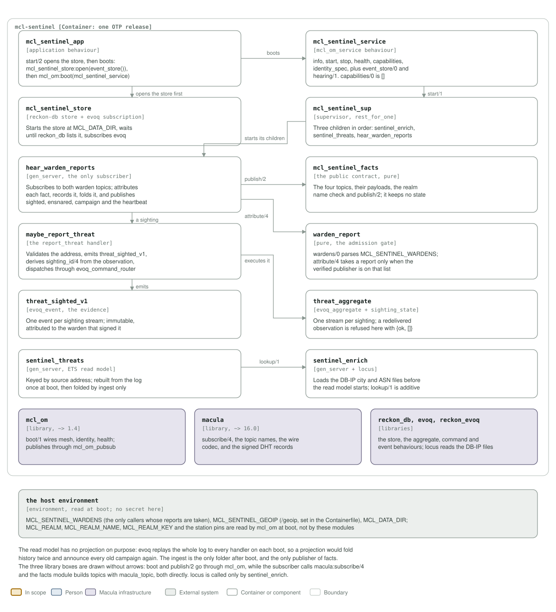

# mcl-sentinel architecture: C4 model

*This exists so a reader can see what mcl-sentinel talks to, and what it is made
of, without reading it.*

**Status: one release, one container, four published facts.** 0.3.0 is the wire
1.0 release. The service hears two warden topics, records each sighting as an
event in its own reckon-db store, keeps a read model in ETS, and publishes
`attacker_sighted_v1`, `attacker_ensnared_v1`, `campaign_detected_v1` and a
60-second heartbeat. `capabilities/0` is empty: nothing on the mesh calls it.

## Level 1: system context

| Element | Kind | Role |
| --- | --- | --- |
| mcl-sentinel | In scope | One OTP release in one container, an `mcl_om` mesh service on its own box. Subscribes to the warden topics, records, correlates and publishes |
| Service operator | Person | Deploys the release, lists the wardens in `MCL_SENTINEL_WARDENS`, and mounts the DB-IP files |
| Threat commons consumers | External system, mesh services | Any mesh service that wants to know who is attacking. It reads the four facts on the realm |
| Warden boxes | External system, `mcl-warden` | The wardens this sentinel is configured with publish `attacker_sighted` and `attacker_ensnared`. No other publisher is heard |
| macula-realm | Macula infrastructure | Endorses the node's identity key and grants the one scope the service asks for, `mcl-sentinel` |
| Macula stations, mesh DHT | Macula infrastructure | The pinned stations are its mesh entry points over QUIC; the facts go out through them |
| Event store | External system, host directory | `/data` holds the reckon-db store. `threat_sighted_v1` is the evidence an abuse report is built from, kept off the attacked boxes |
| DB-IP Lite | External system | `dbip-city-lite.mmdb` and `dbip-asn-lite.mmdb`, mounted read-only at `/geoip` and read through `locus` |

The relationship with the wardens is one-way: a warden publishes what it saw,
and the sentinel never calls it back. Only a warden on the configured list is
heard, and only by the publisher macula verified; nothing a payload says about
its own sender is believed. With no DB-IP files the facts simply carry no
country, city or ASN.

## Level 2: containers and components

| Component | Technology | Responsibility |
| --- | --- | --- |
| `mcl_sentinel_app` | application behaviour | `start/2` opens the store before `mcl_om:boot/1`, so the record slice and the read model find it up. A store that refuses to open stops the boot |
| `mcl_sentinel_service` | the `mcl_om_service` behaviour | The six callbacks, plus `event_store/0` and `hearing/1`. `start/1` refuses a realm name whose sha256 is not the realm tag; `health/0` is `down` when the ingest is not running and `degraded` until both warden topics are subscribed |
| `mcl_sentinel_store` | reckon-db store and evoq subscription | Starts the store at `MCL_DATA_DIR` with indexes on `event_type` and the payload's `source_ip`, waits until `reckon_db` lists it, then starts the per-store `evoq` subscription |
| `mcl_sentinel_sup` | supervisor, `rest_for_one` | Three children in order: `sentinel_enrich`, `sentinel_threats`, `hear_warden_reports`. Enrichment loads before the read model rebuilds against it, and the model is up before the ingest folds into it |
| `hear_warden_reports` | `gen_server`, the only subscriber | Subscribes to both warden topics, attributes each fact, dispatches it, folds a recorded sighting into the read model, and publishes. Also owns the epoch, the sequence and the 60-second heartbeat |
| `warden_report` | pure, the admission gate | `wardens/0` parses `MCL_SENTINEL_WARDENS` from our own inventory; `attribute/4` takes a report only when macula verified its publisher and that publisher is on the list |
| `mcl_sentinel_facts` | the public contract, pure | The four topics, their payload shapes, the realm-name check and `publish/2`. The contract is pinned by `mcl_sentinel_facts_tests` |
| `maybe_report_threat` | the `report_threat` handler | Validates the address, emits `threat_sighted_v1`, derives `sighting_id/4` from the observation so a redelivery lands on the same stream, and dispatches through `evoq_command_router` |
| `threat_aggregate` | `evoq_aggregate` plus `sighting_state` | One stream per sighting. An already-recorded stream answers the sanctioned no-op `{ok, []}`, which is how a redelivery is refused without inflating the record |
| `threat_sighted_v1` | `evoq_event` | The immutable event, attributed to the warden that signed the report |
| `sentinel_threats` | `gen_server`, ETS read model | Keyed by source address. Rebuilt from the log once at boot, then folded only by the live ingest; an address seen by its second warden is a campaign |
| `sentinel_enrich` | `gen_server` plus `locus` | Loads the DB-IP city and ASN files synchronously before the read model starts, and answers `lookup/1`. Additive: absent files mean no geolocation |
| `mcl_om` | library, `~> 1.4` | `boot/1`: mesh, identity, health, and the publish path through `mcl_om_pubsub` |
| `macula` | library, `~> 16.0` | `subscribe/4`, the topic names, the wire codec and the signed DHT records |
| `reckon_db, evoq, reckon_evoq` | libraries | The store, and the aggregate, command and event behaviours the record slice implements |
| the host environment | environment, read at boot | `MCL_SENTINEL_WARDENS`, `MCL_SENTINEL_GEOIP` (`/geoip`, set in the Containerfile), `MCL_DATA_DIR`; the realm, its key and the station pins are read by `mcl_om` |

There is no projection, on purpose: `evoq` replays the whole log to every
handler on each boot with nothing marking it as a replay, so a projection would
fold history twice and announce every old campaign again as new. The read model
therefore has exactly one folder after boot, the live ingest.

## Drawing them

`assets/c4-context.svg` and `assets/c4-components.svg` are generated by
`architecture/c4_diagrams.py` (`python3 architecture/c4_diagrams.py`), from the
code and never from this page: the callbacks in `mcl_sentinel_service.erl`, the
children in `mcl_sentinel_sup.erl`, the store in `mcl_sentinel_store.erl`, the
ingest in `hear_warden_reports.erl` and `warden_report.erl`, the
`record_threat/` slice, `query_threats/sentinel_threats.erl`,
`enrich_attackers/sentinel_enrich.erl`, the fact contract in
`mcl_sentinel_facts.erl`, the dependencies in `rebar.config`, and the
environment in `config/sys.config.src`, the `Containerfile` and
`deploy/docker-compose.yml`. When one of those changes, the diagram changes in
the same commit.

**Where the station list comes from.** It is not in `config/sys.config.src`: `mcl_om` reads `MACULA_STATION_SEEDS` and `MACULA_STATION_NODE_IDS` from the environment at boot, paired index for index, so this repository pins no station and the list may be any length.

Two rules for the files themselves, so they render everywhere they are read
(GitHub, an IDE, `rsvg-convert`): self-contained SVG, and literal colours in
plain classes plus a `prefers-color-scheme` dark block, never CSS custom
properties, which `rsvg-convert` renders black.

The check that keeps them here is the `c4-model` job in
`.github/workflows/c4-model.yml`. It is red until both files exist and are
shown, and it stays red if either one goes missing.
